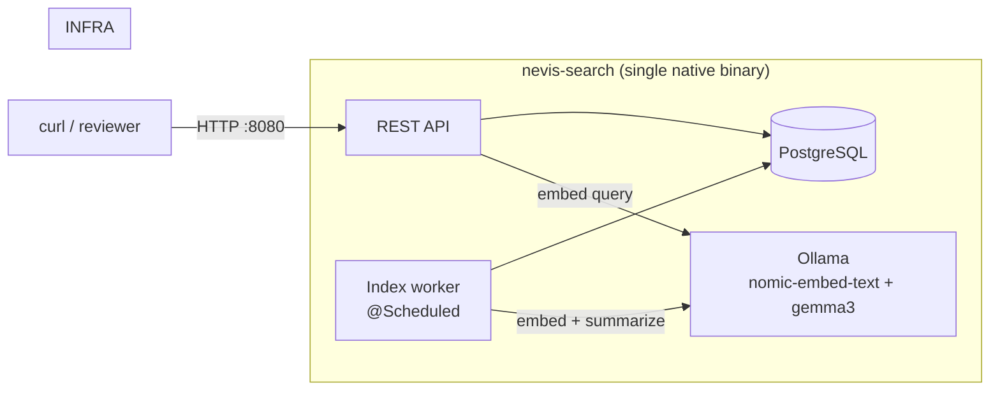

# Nevis Search API

A home-assignment service for the Nevis WealthTech platform: a REST API to
register clients and their documents, plus a unified **Search API** over both,
combining classic lexical matching with local-model semantic search.

Implements the three task cases:

1. **Clients by email / name / description** — a query like `NevisWealth`
   finds the client with email `john.doe@neviswealth.com`
   (camelCase tokenization + case-insensitive substring + trigram fuzzy matching via `pg_trgm`).
2. **Documents by similar terms** — a query like `address proof` finds documents
   containing `utility bill` (embeddings + cosine similarity via `pgvector`,
   model served locally by Ollama).
3. **Optional: quick document summary** — a background worker generates a
   one-line summary per document with a small local chat model (`gemma3:270m`).

**Stack**: Kotlin + Quarkus, compiled to a single native binary (GraalVM/Mandrel),
PostgreSQL with `pgvector` + `pg_trgm`, Ollama for embeddings and summaries.

## Architecture



- `POST /clients`, `POST /clients/{id}/documents` write to Postgres and return
  `201` with a `Location` header.
- New documents land in the `documents` table with `index_status = pending`.
- A background worker (inside the same binary, a `@Scheduled` loop) claims
  pending documents (`FOR UPDATE SKIP LOCKED`), chunks the content, embeds
  the chunks + title, stores vectors in `document_chunks` (pgvector, HNSW
  cosine index) and writes the LLM summary. Documents become **semantically
  searchable only after indexing**; lexical search works immediately.
- `GET /search?q=...` runs two searches in parallel:
  - **clients** — lexical only (substring over tokenized query + `pg_trgm`
    similarity against email / names / description);
  - **documents** — semantic (query embedding vs chunk embeddings, cosine)
    **merged with** lexical (trigram over title/content). The lexical branch
    doubles as a fallback while a document is still indexing, and when
    Ollama is unavailable.
- Results are merged into one list ordered by score. Scores are per type:
  clients get `1.0` for a substring hit, otherwise the trigram similarity;
  documents get the cosine similarity of the best chunk (or the same lexical
  scheme). The `matched` field lists which fields produced the hit.

## Quick start

Requires only Docker (with the Compose plugin):

```bash
docker compose up -d --build
```

The first run takes a while: the build stage compiles a native image inside a
Mandrel container (~5–10 min), and `ollama-init` downloads the two models
(~0.6 GB, cached in the `ollama` volume).

Then open:

- API: http://localhost:8080
- Swagger UI: http://localhost:8080/q/swagger-ui
- OpenAPI contract: http://localhost:8080/q/openapi — served verbatim from
  `src/main/resources/META-INF/openapi.yaml`

Demo data with example searches:

```bash
docker compose --profile demo up -d
docker compose logs -f seed
```

## API

| Method | Path | Purpose |
|--------|------|---------|
| `POST` | `/clients` | Create a client; `201` + `Location`, `409` on duplicate email |
| `GET` | `/clients/{id}` | Fetch a client |
| `POST` | `/clients/{client_id}/documents` | Attach a document; `404` if the client is unknown |
| `GET` | `/clients/{client_id}/documents` | List documents of a client (no content, with summaries) |
| `GET` | `/clients/{client_id}/documents/{document_id}` | Fetch one document with content and summary |
| `GET` | `/search?q=&type=&limit=` | Unified search; `type` = `client` \| `document` (optional), `limit` 1–50, default 10 |

Notes:

- **The contract is spec-first**: `src/main/resources/META-INF/openapi.yaml`
  (OpenAPI 3.1) is the single source of truth. Quarkus serves it verbatim at
  `/q/openapi` (annotation scanning is disabled), and the Gradle
  `openApiGenerate` task generates the HTTP DTOs into `build/generated` before
  `compileKotlin`. Routes, domain logic and SQL stay handwritten.
- Fields use snake_case in JSON as in the assignment spec (`first_name`,
  `client_id`, …); Kotlin properties are camelCase with Jackson mappings from
  the generator.
- `POST` bodies are validated (Hibernate Validator, annotations come from the
  spec's `x-field-extra-annotation`): `400` with
  `application/problem+json` on invalid input; errors follow RFC 7807.
- Emails are stored lowercased; the uniqueness constraint is therefore
  case-insensitive (`409` on duplicates in any case).
- Document responses include `summary` and `index_status`
  (`pending` / `indexing` / `indexed` / `failed`) — search returns documents
  as soon as they are lexically visible, summaries appear after indexing.

## Example queries and responses

Captured from a live run (`make demo`), lightly reformatted.

Create a client:

```http
POST /clients
{"first_name": "John", "last_name": "Doe", "email": "John.Doe@NevisWealth.com",
 "description": "Senior wealth advisor at Nevis Wealth management, focuses on retirement portfolios",
 "social_links": ["https://linkedin.com/in/john-doe"]}
```

```http
HTTP/1.1 201 Created
Location: http://localhost:8080/clients/65459893-102d-41a7-a315-67fa5666727d

{"id":"65459893-102d-41a7-a315-67fa5666727d","first_name":"John","last_name":"Doe",
 "email":"john.doe@neviswealth.com",
 "description":"Senior wealth advisor at Nevis Wealth management, focuses on retirement portfolios",
 "social_links":["https://linkedin.com/in/john-doe"],
 "created_at":"2026-11-24T16:23:04.636715Z"}
```

**Case 1 — client by email/name/description.** `NevisWealth` matches the
email domain (`neviswealth.com`) through camelCase tokenization:

```json
[
  {
    "type": "client",
    "score": 1.0,
    "matched": ["email", "description"],
    "snippet": null,
    "client": {
      "id": "65459893-102d-41a7-a315-67fa5666727d",
      "first_name": "John",
      "last_name": "Doe",
      "email": "john.doe@neviswealth.com",
      "description": "Senior wealth advisor at Nevis Wealth management, focuses on retirement portfolios",
      "social_links": ["https://linkedin.com/in/john-doe"],
      "created_at": "2026-11-24T16:23:04.636715Z"
    },
    "document": null
  }
]
```

**Case 2 — documents by similar terms.** `address proof` finds the utility
bill document whose text never contains the words "address" or "proof" —
the hit comes from the embedding similarity (0.533 over the `min-score` of
0.51); the snippet is the best-matching chunk. Other document kinds stay
below the threshold on this corpus (passport 0.507, bank statement 0.478,
employment contract 0.471, royalty statement 0.437), so a single relevant
result comes back:

```json
[
  {
    "type": "document",
    "score": 0.5330629427583119,
    "matched": ["content"],
    "snippet": "Monthly electricity utility bill issued for the property where the customer lives. Utility bills like this one are commonly requested to verify where a person lives and are accepted as a household document for verification.",
    "client": null,
    "document": {
      "id": "02b14b86-c845-4b98-ad71-04d2af486cf3",
      "client_id": "65459893-102d-41a7-a315-67fa5666727d",
      "title": "Utility bill for 42 Baker Street",
      "summary": "The utility bill for 42 Baker Street shows a monthly electricity bill, typically requested for verifying a household residence.",
      "index_status": "indexed",
      "created_at": "2026-11-24T16:23:04.882893Z"
    }
  }
]
```

**Bonus — the generated summaries** (the optional task case), from
`GET /clients/{client_id}/documents`:

```json
[
  {"id": "fa78fa9f-…", "title": "Bank statement Q1",
   "summary": "The bank statement shows the balance of its outstanding accounts, including deposits, dividends, and regular salary deposits.",
   "index_status": "indexed", "…": "…"},
  {"id": "1ff9bf57-…", "title": "Passport scan",
   "summary": "The document describes a passport scan.",
   "index_status": "indexed", "…": "…"},
  {"id": "02b14b86-…", "title": "Utility bill for 42 Baker Street",
   "summary": "The utility bill for 42 Baker Street shows a monthly electricity bill, typically requested for verifying a household residence.",
   "index_status": "indexed", "…": "…"}
]
```

**Bonus — fuzzy name match.** `Jonh Doe` (a typo) still finds John Doe:
`"doe"` matches as a substring, and the misspelled `jonh doe` phrase matches
via trigram similarity:

```json
[
  {"type": "client", "score": 1.0, "matched": ["email", "last_name"], "snippet": null,
   "client": {"id": "d48c078b-…", "first_name": "John", "last_name": "Doe",
              "email": "john.doe@neviswealth.com", "…": "…"},
   "document": null}
]
```

## How the two search modes work

**Client search (lexical).** The query is lowercased and tokenized; camelCase
words yield both joined and split forms (`NevisWealth` →
`neviswealth`, `nevis`, `wealth`). A client matches when any token is a
substring of the lowercase email / first / last name / description
(regex `~`), or when the full lowercase phrase has a `pg_trgm` similarity ≥
`search.lexical.min-similarity` (0.3) against any field — which also catches
typos like `Jonh Doe` for `John Doe`. Substring hits score `1.0`, trigram-only
matches score their similarity.

**Document search (semantic + lexical).** The query is embedded with
`nomic-embed-text:v1.5` (768 dims, `search_query:` prefix) and compared to
every stored chunk vector (chunks carry the `search_document:` prefix) with
cosine distance (`<=>`, HNSW index); documents above
`search.semantic.min-score` (0.51) are returned with the best-matching chunk
as the `snippet`. The threshold is content-sensitive: Nomic puts relevant
texts around 0.5–0.6 on this corpus and unrelated document kinds around
0.45–0.51, so 0.51 is calibrated for the demo corpus — expect to re-tune it
when the corpus changes. Lexically matched documents are merged in (or take
over entirely if Ollama is unreachable), so a freshly uploaded document is
findable by its literal words before the worker processes it.

**Indexing.** Content is split into ~900-char word-aligned chunks with a
~120-char overlap; the title is embedded as an extra chunk so short documents
stay semantically reachable. Embeddings are committed first, so the document
becomes searchable immediately after that; the summary is a best-effort
follow-up — if the chat model is unavailable, the document stays searchable
with a `null` summary and the reason recorded in `index_error`. Transient
embedding failures (Ollama restarting, model still loading) put the document
back into `pending` without counting an attempt; after
`search.worker.max-attempts` hard failures the document is marked `failed`
with the last error in `index_error`.

## Design decisions & trade-offs

- **One binary, one process.** The API and the indexing worker share the
  process — the worker is a `@Scheduled` poller over a Postgres queue. No
  message broker; `FOR UPDATE SKIP LOCKED` keeps it correct even if the
  binary is scaled to several replicas.
- **Postgres does the search work.** No Elasticsearch/OpenSearch: pg_trgm and
  pgvector cover both match types, keeping the stack at three containers and
  making the search SQL inspectable in one place.
- **Local models, no external API.** Embeddings (`nomic-embed-text:v1.5`,
  768 dims, with the model's query/document prefixes) and summaries
  (`gemma3:270m`) run in a local Ollama container; no data leaves the
  machine, which fits the advisory context.
- **Scores are per-type, not absolute relevance.** A client substring hit
  (`1.0`) and a document cosine similarity are not on one calibrated scale;
  the response exposes both, ordered by score, and callers can filter by
  `type`. Cross-type ranking calibration (e.g. Reciprocal Rank Fusion) would
  be the next step if mixed lists become important.
- **Embedding dimension is tied to the model.** `document_chunks.embedding`
  is `vector(768)` (nomic-embed-text). Switching the embedding model means a
  schema change, a full reindex and threshold recalibration.
- **Client search stays lexical by design.** The task's client example is a
  tokenized/fuzzy match; embedding client descriptions would add semantic
  matching for descriptions but was left out to keep the search modes
  distinct and the latency of client search at a single indexed SQL query.

## Configuration

All knobs live in `src/main/resources/application.yml` and can be overridden
by environment variables (see `docker-compose.yml`):

| Key | Default | Meaning |
|-----|---------|---------|
| `search.worker.interval` | `2s` | Index worker polling interval |
| `search.worker.batch-size` | `8` | Documents per worker cycle |
| `search.worker.max-attempts` | `3` | Hard failures before `failed` |
| `search.lexical.min-similarity` | `0.3` | pg_trgm threshold for clients and documents |
| `search.semantic.min-score` | `0.20` | Cosine similarity threshold for documents |
| `search.lexical.max-query-length` | `256` | Query length cap |
| `ollama.embedding-model` | `nomic-embed-text:v1.5` | Embedding model (must produce 768 dims) |
| `ollama.chat-model` | `gemma3:270m` | Summarization model |
| `OLLAMA_URL` | `http://localhost:11434` | Ollama base URL |

## Tests

```bash
make test
```

- **Unit** (`text/`): tokenizer camelCase/splitting behavior, chunker
  boundaries and overlap.
- **Integration** (`api/`, `worker/`): the full HTTP surface — creation,
  validation, `409`/`404`/`400` cases, the canonical search examples from the
  task, and the worker's transient/hard failure paths. Quarkus Dev Services
  starts a throwaway `pgvector/pgvector:pg17` container; `LlmClient` is
  replaced by a deterministic fake (CDI alternative), so tests exercise the
  real SQL — `~`, `similarity()`, `<=>` — against real Postgres without
  needing Ollama.

## Code style

Kotlin linting and formatting use ktlint via its Gradle plugin — one tool for
both modes:

```bash
make lint   # ./gradlew ktlintCheck  — check only
make fmt    # ./gradlew ktlintFormat — rewrite files in place
```

`./gradlew check` (and therefore the native image build) runs `ktlintCheck`
as part of the standard lifecycle, so the shipped binary is always built from
lint-clean sources. The generated DTOs under `build/generated` are excluded
from formatting: restyle the spec, not the generated code.

## Limitations / next steps

- Cross-type score calibration (RRF) for mixed results.
- Semantic search over client descriptions.
- Streaming/parallel embedding for very large backfills.
- No auth; the assignment does not require it.
